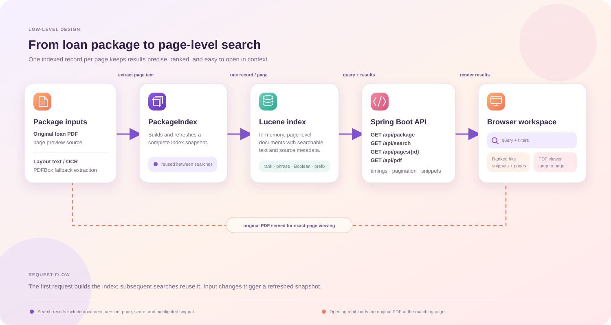
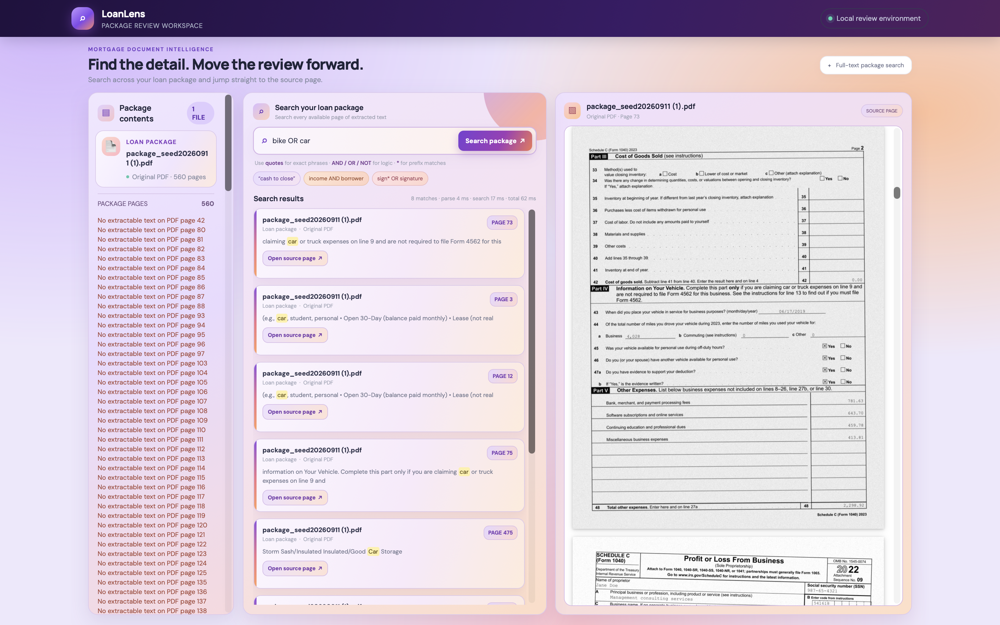
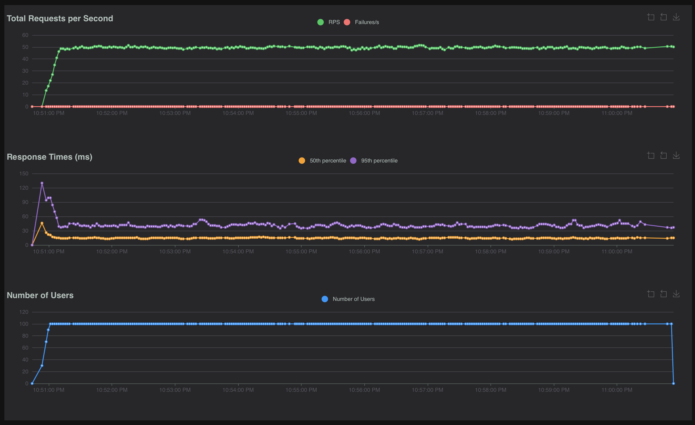
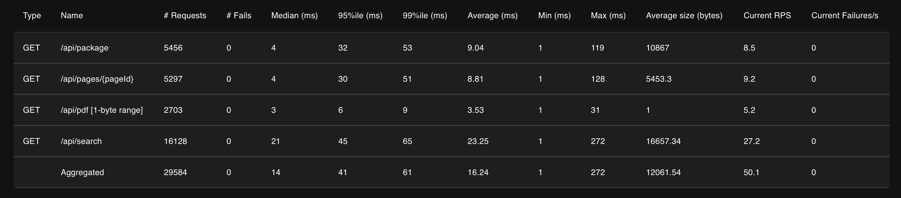

# Loan Package Search

## Design

`PackageIndex` builds a page-level index on first request and reuses it for later searches. Each page stores its text, document metadata, and page number. Search supports phrases, `AND` / `OR` / `NOT`, prefix wildcards, and offset pagination. Selecting a result opens that page in the original PDF. An optional `project/data/package.json` can describe multiple documents and text files.

## UI

The responsive review workspace shows package contents, query examples, ranked snippets with highlighted terms, search timings, and the original PDF at the selected result page.

## Performance

**Local 10-minute run · 100 simulated users · ~50 requests/second · 0 failures across 29,584 requests.** After ramp-up, throughput stayed close to 50 RPS. Aggregate latency was 14 ms median, 41 ms p95, and 61 ms p99 (16.24 ms average).

| API | Requests | Median | p95 | p99 | Average |
|---|---:|---:|---:|---:|---:|
| `/api/search` | 16,128 | 21 ms | 45 ms | 65 ms | 23.25 ms |
| `/api/package` | 5,456 | 4 ms | 32 ms | 53 ms | 9.04 ms |
| `/api/pages/{pageId}` | 5,297 | 4 ms | 30 ms | 51 ms | 8.81 ms |
| `/api/pdf` · 1-byte range | 2,703 | 3 ms | 6 ms | 9 ms | 3.53 ms |

The PDF measurement is for a one-byte range response, not a full PDF download. Results are from the local test environment and are workload and machine dependent.

## Limitations

- The index is in memory and is rebuilt after restart; large packages require more memory.
- Requests are serialized to keep index replacement safe, limiting concurrent throughput.
- Pages without extractable PDF or layout text cannot be searched.
- The optional manifest format is documented in `project/data/README.md`.
